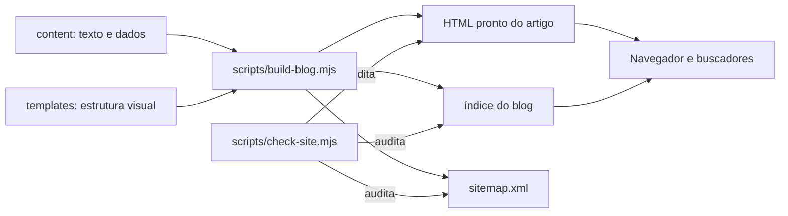

# Aula: como o blog é montado

**Nível:** iniciante  
**Exemplo:** artigo “O que é tráfego pago?”  
**Objetivo:** entender como os arquivos de conteúdo, dados, templates e scripts viram páginas HTML prontas para o navegador.

## 1. A ideia geral

Antes, cada página do blog era escrita inteira em HTML. Isso funciona, mas repetir o cabeçalho, rodapé, cartões, metadados e sitemap torna as atualizações trabalhosas. Uma alteração pequena pode ter de ser copiada para vários arquivos.

Agora, algumas informações foram separadas por função. O artigo continua sendo HTML, os dados descritivos ficam em JSON, os modelos de página ficam em templates e os scripts juntam tudo.



O navegador **não executa esses templates**. O gerador os processa antes e grava HTML normal. Por isso, no Live Server, abra o arquivo gerado em `blog/o-que-e-trafego-pago/`. O arquivo-fonte em `content/o-que-e-trafego-pago.html` é apenas o conteúdo que será encaixado no modelo.

## 2. Por que existe a pasta `content/`?

`content` significa “conteúdo”. A pasta guarda o material que muda de um artigo para outro, separado da estrutura que pode ser reaproveitada.

- [o-que-e-trafego-pago.html](../content/o-que-e-trafego-pago.html) guarda o corpo do artigo: introdução, títulos, parágrafos, imagens e chamada final.
- [o-que-e-trafego-pago.json](../content/o-que-e-trafego-pago.json) guarda dados como o título SEO, a descrição e a data de atualização.
- [posts.json](../content/posts.json) guarda os dados que aparecem nos cartões da listagem e controlam sua ordem.
- [site-pages.json](../content/site-pages.json) guarda as páginas institucionais incluídas no sitemap.

Essa separação deixa mais claro onde fazer cada mudança. Para trocar um parágrafo do artigo, edite o HTML de conteúdo. Para corrigir a descrição que aparece no Google ou em compartilhamentos, edite o JSON de metadados.

## 3. O que é um arquivo `.json`?

JSON é um formato de texto usado para representar dados organizados. Ele usa pares de **chave e valor**:

```json
{
  "slug": "o-que-e-trafego-pago",
  "dateModified": "2026-10-28",
  "seoTitle": "O que é tráfego pago? Como funciona | Raio Local"
}
```

Nesse exemplo, `slug`, `dateModified` e `seoTitle` são chaves; os textos depois dos dois pontos são seus valores. O formato tem algumas regras importantes:

- nomes e valores de texto usam aspas duplas;
- pares são separados por vírgulas;
- não se coloca vírgula depois do último par;
- comentários não são permitidos dentro de JSON.

O script abre o arquivo como texto e usa `JSON.parse(...)` para transformá-lo em dados que o JavaScript consegue consultar. Por exemplo, `pilot.seoTitle` acessa o valor da chave `seoTitle`. Em seguida, o gerador coloca esse valor no lugar do marcador `{{TITLE}}` do template.

JSON não formata a página sozinho. Ele fornece os valores; o script e o template decidem onde esses valores aparecem.

## 4. O que significa `.mjs`?

`.mjs` é uma extensão para arquivos JavaScript que usam **módulos ES**. Módulos permitem importar funções e recursos de outras partes do ambiente. No nosso gerador, por exemplo:

```js
import { readFile, writeFile } from 'node:fs/promises';
```

Essa linha importa funções do Node.js para ler e gravar arquivos. O Node.js é o programa que executa o JavaScript fora do navegador.

O projeto também define `"type": "module"` no [package.json](../package.json). Isso permite usar módulos ES em arquivos `.js`; a extensão `.mjs` deixa explícito que aquele arquivo é um módulo, mesmo sem essa configuração. Aqui usamos `.mjs` nos scripts para deixar clara sua função de ferramenta de build e auditoria.

## 5. Para que servem os templates?

Um template é um modelo com espaços reservados, ou **marcadores**, para as partes variáveis. Veja a ideia simplificada:

```html
<title>{{TITLE}}</title>
<main>
  {{HEADER}}
  {{CONTENT}}
  {{FOOTER}}
</main>
```

O template [article.html](../templates/article.html) contém a estrutura HTML do artigo, inclusive as áreas para metadados e dados estruturados. As partes comuns do cabeçalho e do rodapé ficam em [templates/partials](../templates/partials/). “Partial” quer dizer trecho reutilizável: um pedaço de HTML que entra dentro de outro arquivo.

O template da listagem, [blog-list.html](../templates/blog-list.html), contém o layout do índice e marcadores para o artigo em destaque e os demais cartões. Assim, os cartões são criados com os dados do arquivo `posts.json`, em vez de editar manualmente a listagem toda vez.

## 6. Como funciona o `build-blog.mjs`?

O script [build-blog.mjs](../scripts/build-blog.mjs) é o montador. Em termos simples, ele:

1. Lê os arquivos JSON com `readFile` e transforma o conteúdo de texto em dados com `JSON.parse`.
2. Confere os slugs, as datas e se existe uma página HTML para cada post publicado.
3. Ordena os artigos pela data de publicação e escolhe o primeiro para destaque.
4. Lê o template do índice e troca os marcadores pelos cartões gerados.
5. Lê o template do artigo e combina os metadados JSON, o cabeçalho, o conteúdo HTML e o rodapé.
6. Grava as páginas finais e o sitemap usando `writeFile`.

Uma troca de marcador é feita por uma operação como:

```js
article = article.replaceAll('{{TITLE}}', pilot.seoTitle);
```

O artigo final recebe um título real onde antes existia `{{TITLE}}`. O script também escapa caracteres especiais nos metadados inseridos em HTML para que, por exemplo, um sinal de menor seja escrito com segurança.

Use os comandos do projeto assim:

```sh
npm run build
```

Esse comando executa o script de geração e atualiza os arquivos HTML finais e o sitemap. Depois, abra a página gerada no navegador ou no Live Server. A edição do arquivo-fonte não aparece na página até o próximo build.

## 7. O que faz `check-site.mjs`?

O [check-site.mjs](../scripts/check-site.mjs) é uma auditoria estática: ele lê os arquivos do projeto e procura problemas que podem quebrar navegação ou sinais importantes para buscadores. Ele verifica:

- se links e recursos internos apontam para arquivos que existem;
- se imagens têm atributo `alt`;
- se páginas têm título, descrição e um H1;
- se a URL canonical e `og:url` concordam;
- se as URLs canonical aparecem no sitemap;
- se o JSON-LD pode ser interpretado e aponta para a URL canonical;
- se páginas públicas não estão marcadas como `noindex`;
- se as imagens Open Graph locais existem;
- se há URLs repetidas no sitemap ou caracteres de substituição por erro de codificação.

Para executá-lo:

```sh
npm run audit
```

A auditoria é automática, mas não substitui a revisão humana. Ela não confirma que links externos continuam disponíveis nem que o site publicado no servidor já recebeu o último deploy.

Há também o comando:

```sh
npm run check
```

Ele roda o gerador em modo de conferência, sem gravar arquivos. Se uma página ou o sitemap estiver diferente do que as fontes e templates produzem, o comando indica que a saída está desatualizada.

## 8. Build, check e audit: qual a diferença?

| Comando | Para que serve | Grava arquivos? |
| --- | --- | --- |
| `npm run build` | Gera as páginas HTML e o sitemap | Sim |
| `npm run check` | Confere se as páginas geradas estão sincronizadas | Não |
| `npm run audit` | Procura links e problemas básicos de SEO nos arquivos HTML | Não |

Uma sequência prática antes de publicar:

```sh
npm run build
npm run check
npm run audit
```

## 9. O que editar em cada tarefa?

| Quero… | Edite… | Depois… |
| --- | --- | --- |
| Corrigir o texto do artigo | `content/o-que-e-trafego-pago.html` | Rode `npm run build` |
| Mudar título SEO, descrição ou data de atualização | `content/o-que-e-trafego-pago.json` | Rode `npm run build` |
| Alterar estrutura comum de um artigo | `templates/article.html` ou `templates/partials/` | Rode `npm run build` |
| Alterar o visual/estrutura do índice | `templates/blog-list.html` | Rode `npm run build` |
| Atualizar título, resumo, categoria ou ordem de cartão | `content/posts.json` | Rode `npm run build` |
| Incluir ou remover uma página institucional do sitemap | `content/site-pages.json` | Rode `npm run build` |
| Conferir links e SEO técnico básico | Nenhuma edição necessária | Rode `npm run audit` |

## 10. Resumo

`content/` guarda o material editável; `templates/` define a estrutura reutilizável; `scripts/build-blog.mjs` junta as partes e produz HTML estático; `scripts/check-site.mjs` verifica arquivos e referências locais. O site publicado continua entregando HTML pronto, com suas URLs e metadados, sem precisar executar o gerador para cada visitante.
